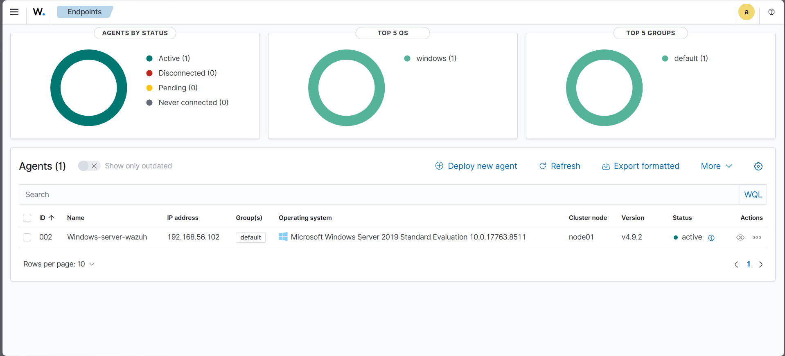
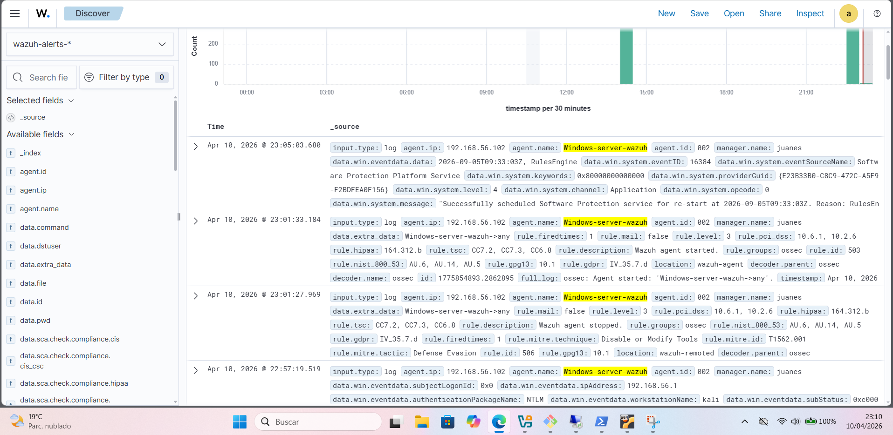

# Home security lab with Wazuh SIEM

A small virtual lab where I attack a Windows Server from Kali and check what those attacks look like in Wazuh. Part of my cybersecurity portfolio.

## Lab architecture

| Machine | OS | Role | IP |
|---|---|---|---|
| Kali Linux | Kali 2024 | Attacker | 192.168.56.1 |
| Windows Server | Server 2019 | Target, running the Wazuh agent | 192.168.56.102 |
| Ubuntu + Wazuh | Ubuntu 22.04 | SIEM, Wazuh 4.9 | 192.168.56.104 |

All three run in VirtualBox. The Windows Server reports to Wazuh through the agent.

## What I did

### 1. Reconnaissance

`nmap -sV -sC -T4` against the Windows Server. Open ports: 135, 139, 445, 3389, 5357 and 5985.

### 2. Brute force against RDP

Hydra with the `administrator` account and a six-password list. No valid password was found, and the attempts left a trace in Wazuh.

## What Wazuh showed

- The Hydra attempts as NTLM logon events from the workstation `kali` (192.168.56.1), one second after Hydra finished
- Windows logon and logoff events, remote logons, and special privileges assigned to new logons
- The Wazuh agent being stopped, which Wazuh maps to MITRE ATT&CK T1562.001 (Disable or Modify Tools)

## Tools

VirtualBox 7 · Wazuh 4.9 · Nmap 7.98 · Hydra 9.5 · Kali Linux 2024

Juan Esteban Umaña Machado · linkedin.com/in/juanesumaa11
